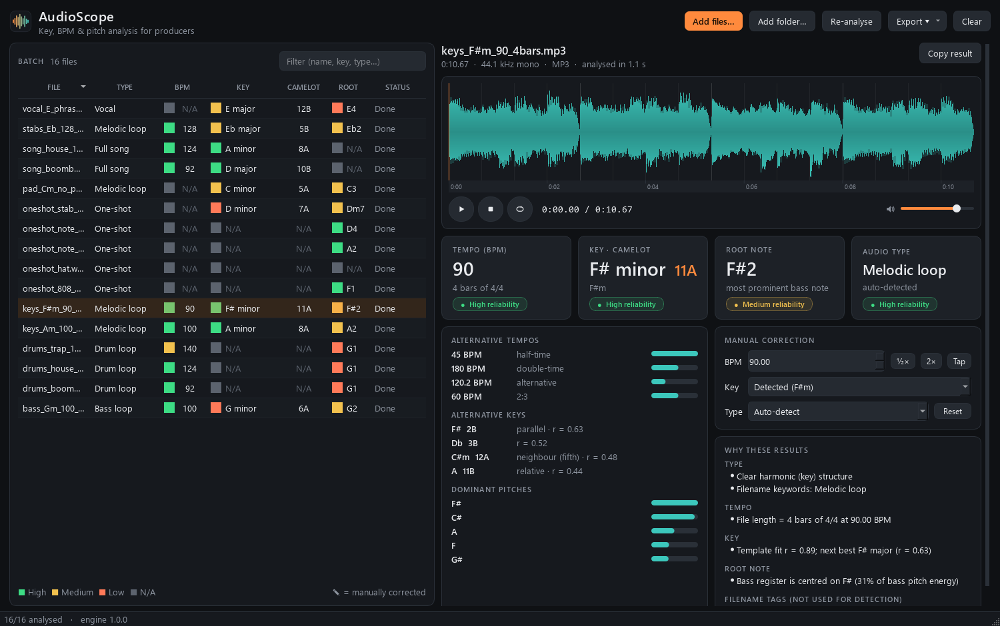

# AudioScope

Key, BPM and root-note analysis for music producers. Drop in full songs, drum loops,
melodic loops, bass loops, vocals or one-shots (WAV, MP3, FLAC); AudioScope classifies
each file, detects tempo, musical key (standard + Camelot) and root note with a strategy
suited to that kind of audio, and tells you **how much to trust each result** — or says
**N/A** when a value cannot be meaningfully determined.



## Features

* Drag-and-drop files or whole folders; batch analysis on all CPU cores
* Automatic audio-type classification with manual override (re-analyses with that type's strategy)
* BPM from onset periodicity, beat tracking and exact loop length (bar counting), with
  half-time / double-time alternatives always shown
* Key from tuning-corrected chroma (Krumhansl-Kessler + Temperley profiles), Camelot code,
  alternative keys, tuning offset in cents
* Root note: fundamental of one-shots and 808s (with cents), chord name for chord stabs,
  most frequent note of bass/vocal lines, most prominent bass note of melodic loops —
  kept separate from the key
* Reliability per result (High / Medium / Low / N/A) derived from measured evidence, plus
  a plain-language "why these results" panel; no invented percentages
* Interactive waveform with beat/bar grid, click-to-seek, play/stop/loop, volume
* Manual correction (BPM with ½× / 2× / tap tempo, key, type) remembered between sessions
* Export CSV or full-detail JSON; copy result to clipboard
* Command-line tool for scripting

## Install / run

### Packaged app
Unzip `AudioScope-windows-x64.zip` and run `AudioScope\AudioScope.exe`
(no Python needed). `audioscope-cli.exe` in the same folder is the command-line version.
You can also drag files onto `AudioScope.exe`.

### From source (Python 3.11+, tested with 3.14 on Windows 11)
```powershell
python -m venv .venv
.venv\Scripts\pip install -r requirements-dev.txt
.venv\Scripts\python -m audioscope              # GUI
.venv\Scripts\python -m audioscope.cli loops\   # CLI (add --json for full output)
```

### Build the Windows package
```powershell
powershell -ExecutionPolicy Bypass -File packaging\build.ps1
```
Produces `dist\AudioScope\` (GUI + CLI sharing one runtime, ~360 MB unpacked, mostly
Qt and the LLVM JIT used by librosa/numba) and `dist\AudioScope-windows-x64.zip`. The
script runs a headless self-test of the frozen build (`AudioScope.exe --selftest <audio> <out.json>`).

## How detection works

| Audio type | Tempo | Key / pitch |
|---|---|---|
| Full song | percussive + spectral-flux onsets, analysed in overlapping 24 s sections and aggregated; section agreement affects reliability | chroma per 30 s section and overall; modulation flagged |
| Drum loop | transient (percussive) onsets, loop treated as periodic, exact length tested against 1–32 bars | key only from tuned drums/808s, capped at Low |
| Melodic loop | note/chord onsets + loop length | chroma key; opening bass note breaks near-ties with the relative key; most prominent bass note |
| Bass loop | note onsets + loop length | key from tracked notes (pYIN), capped at Medium; most frequent note |
| Vocal | note onsets — legato phrases usually give **N/A** | key from tracked notes, capped at Medium; most frequent note |
| One-shot | always N/A | fundamental (pYIN, glides ignored) or chord name; single notes have **no key** |

Key points:

* **Half/double-time**: the metrical family is chosen by periodicity; the octave within it
  by a broad tempo prior and onset density. The other octave is always listed, and the
  result is marked when both are plausible (e.g. DnB 174 vs 87).
* **Loops**: if the file is an exact number of bars at the detected tempo, the BPM comes
  from the sample-accurate length (e.g. 128.00 for 4 bars of 7.5 s).
* **N/A** is returned when there are no distinct attacks (pads, drones, legato vocals),
  no pitch (noise, hats), fewer than three pitch classes (single note, power chord), or
  pitch content that fits no major/minor key.
* **Filename tags** like `128bpm_F#min` are shown for comparison but never used as results.

### Reliability
Not a probability. Derived from measurable evidence:

* BPM: strength of the periodicity, exact-bar loop length, agreement across song sections,
  half/double ambiguity.
* Key: template correlation, margin over the runner-up, distance to the relative key,
  section agreement, and caps for material that cannot pin a key down (single lines, drums).
* Root: voicing, pitch stability, share of pitched energy on one note.

`eval/evaluate.py` measures accuracy per reliability level so the labels can be checked
and re-tuned against your own labelled audio.

## Accuracy

On a synthetic evaluation corpus (see [`eval/README.md`](eval/README.md)):
songs BPM 95 % / key 80 %, loops BPM 85.5 % (93.6 % allowing half/double) / key 83.5 %,
one-shots root note 100 % (median 2 ¢ error), N/A correctly returned for all one-shot
tempos and single-note keys. High-reliability results: BPM 98.7 %, key 95.8 % correct.
**These are upper bounds — the corpus is synthesised, not real recordings.** Evaluate on
your own labelled samples with `eval/evaluate.py --dataset`.

## Project layout

```
audioscope/
  engine/            analysis engine — no Qt dependency, reusable (e.g. from a VST3 host)
    io.py            decoding (libsndfile; FFmpeg fallback)
    features.py      shared, cached features (HPSS, onset envelopes, CQT, salience)
    tempo.py         BPM
    key.py           key + Camelot
    pitch.py         root note / chords / dominant pitches
    classify.py      audio type
    analyzer.py      per-type strategy, filename hints
    types.py         JSON-serialisable result dataclasses
  ui/                PySide6 interface (main window, waveform, player, worker pool)
  cli.py             command-line interface
tests/               pytest suite (synthetic signals + rendered reference fixtures)
eval/                accuracy evaluation per category + calibration
packaging/           PyInstaller spec, icon, build script
```

### Engine API
```python
from audioscope.engine import analyze_file, AudioType
r = analyze_file("loop.wav")                    # or audio_type=AudioType.BASS_LOOP
r.tempo.bpm, r.tempo.reliability, r.tempo.candidates
r.key.key.name, r.key.key.camelot, r.key.candidates
r.pitch.root_name, r.pitch.root_cents, r.pitch.chord
r.to_dict()                                     # JSON-ready
```
The engine works on mono float32 at 22.05 kHz (`analyze_audio(AudioData)`), so a plugin
host can feed it captured buffers instead of files.

## Tests

```powershell
.venv\Scripts\python -m pytest            # ~165 tests, ~1.5 min
.venv\Scripts\python tests\make_fixtures.py   # regenerate reference fixtures
```

## Notes and limitations

* **Essentia** was considered but not used: it has no Windows wheels on PyPI (source build
  only) and is AGPL-3.0, which would constrain distribution of the app and a future plugin.
* Assumes 4/4 for loop bar counting; odd meters still get an onset-based BPM.
* Songs with tempo changes report one tempo and flag disagreement between sections.
* Key detection models major/minor only; modal, atonal or heavily chromatic material
  gives low reliability or N/A.
* Relative major/minor is the hardest call (identical notes); AudioScope always shows the
  relative key as an alternative and lowers reliability when the two are close.

## Licences of dependencies
librosa (ISC), NumPy/SciPy (BSD), soundfile (BSD) + libsndfile (LGPL-2.1), soxr (LGPL-2.1),
numba/llvmlite (BSD), PySide6/Qt (LGPL-3.0). The packaged app ships these as separate
shared libraries.
